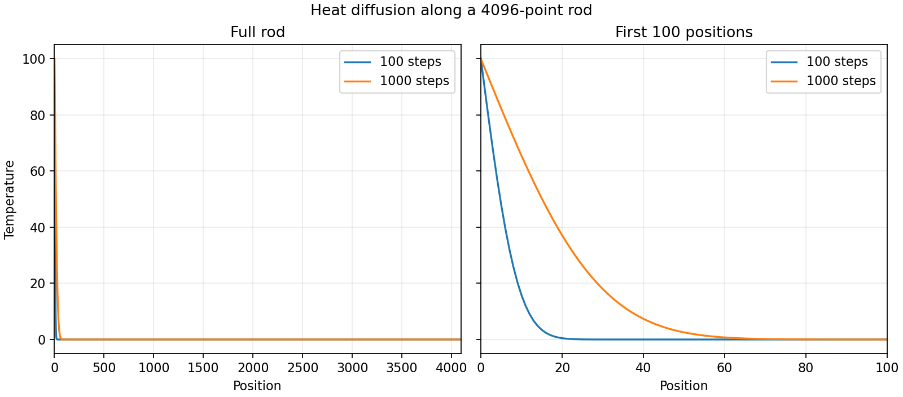

# Лабораторийн ажил №4 — Параллел ба хуваарилагдсан тооцоолол

## Ажлын зорилго

Энэ лабораторийн ажил хоёр хэсэгтэй. Эхний хэсэгт хоёр серверийг хооронд нь холбож, чатны мессеж дамжуулах, клиентүүдийг хуваарилах, нэг сервер унтарсан үед үйлчилгээг үргэлжлүүлэх ажиллагааг судлав. Хоёрдугаар хэсэгт метал саваан дахь дулааны тархалтыг дөрвөн MPI процессоор тооцоолж, процессууд хэсгийнхээ захын температурыг хэрхэн солилцохыг шалгав. [Даалгаврын PDF](Lab-04.pdf)

## I хэсэг — Хоёр сервертэй чат

### Хэрэгжүүлэлт

Node.js дээр хоёр тусдаа серверийн процесс ажиллуулав. A сервер `8001`, B сервер `8002` портыг ашиглана. Клиент сервертэй Socket.IO-оор холбогдож, терминалаас мессеж илгээнэ. Сервер бүр өөрт нь холбогдсон клиентүүдийн дугаарыг хадгалж, холболт нэмэгдэх болон тасрах бүрд жагсаалтаа шинэчилнэ. [Серверийн код](chat/server.js) · [Клиентийн код](chat/client.js)

Хэрэглэгчийн мессежийг хүлээн авсан сервер эхлээд өөрийн клиентүүдэд түгээгээд, дараа нь нөгөө сервер рүү `/peer` сувгаар дамжуулна. Нөгөө сервер мессежийг зөвхөн өөрийн клиентүүдэд түгээнэ. Иймээс мессеж хоёр серверийн хооронд давтан дамжихгүй. Жишээлбэл, A-д холбогдсон 2-р клиент мессеж илгээхэд A дээрх 2, 4-р клиент болон B дээрх 1, 3-р клиент тус бүр нэг удаа хүлээн авна. B-ээс A руу мөн адил дамжина.

Клиентийг дугаарын тэгш, сондгойгоор хуваарилав. Тэгш дугаартай клиент эхлээд A-д, сондгой дугаартай клиент B-д холбогдоно. A-д холбогдох оролдлого амжилтгүй болох эсвэл A-тай тогтоосон холболт тасрах үед тухайн клиент B рүү шилжинэ.

### Туршилтын явц ба үр дүн

| Туршилт | Ажиглагдсан үр дүн |
| --- | --- |
| 1–4 дугаартай клиентийг холбосон | A-д 2, 4-р клиент, B-д 1, 3-р клиент холбогдож, ачаалал хоёр серверт 2:2-оор хуваарилагдсан. |
| A-гаас B рүү мессеж дамжуулсан | 2-р клиентийн мессежийг 1–4-р клиент тус бүр нэг удаа хүлээн авсан. |
| B-гээс A руу мессеж дамжуулсан | 1-р клиентийн мессежийг 1–4-р клиент тус бүр нэг удаа хүлээн авсан. |
| A серверийг унтраасан | A дээр байсан 2, 4-р клиент B-д шилжсэн. B дээрх 3-р клиентийн мессежийг 1–4-р клиент тус бүр нэг удаа хүлээн авсан. |
| A унтарсан үед 6-р клиентийг шинээр холбосон | 6-р клиент B-д холбогдож, илгээсэн мессежийг B дээрх 1, 2, 3, 4, 6-р клиент тус бүр нэг удаа хүлээн авсан. |

[Чатын туршилтын лог](results/chat.log)

### Дахин ажиллуулах

Node.js болон npm суусан орчинд репогийн үндсэн хавтсаас ажиллуулна.

```bash
npm --prefix lab04/chat ci
npm --prefix lab04/chat run demo
```

Гараар турших бол доорх мөр бүрийг тусдаа терминалд ажиллуулна. Клиентийн терминалд мессеж бичээд Enter дарна.

```bash
node lab04/chat/server.js B
node lab04/chat/server.js A
node lab04/chat/client.js 1
node lab04/chat/client.js 2
node lab04/chat/client.js 3
node lab04/chat/client.js 4
```

Доголдлыг туршихдаа A серверийг Ctrl+C-ээр зогсоож, B дээрх 1, 3-р клиентээр мессеж солилцоно. Дараа нь `node lab04/chat/client.js 6` командаар шинэ клиент ажиллуулж, B-д холбогдсоныг шалгана.

## II хэсэг — Метал савааны дулааны тархалт

### Загвар ба процессын хуваарилалт

Савааг 4096 цэгтэй нэг хэмжээст массиваар төлөөлүүлэв. Эхний агшинд зүүн захын температур `100.0`, бусад бүх цэгийн температур `0.0` байв. Тооцооллын турш зүүн болон баруун захын температурыг тус тус `100.0`, `0.0`-д тогтмол барив. Дулаан дамжуулалтын коэффициентийг даалгаварт өгсөн `C = 0.25` утгаар авсан.

| MPI процесс | Хариуцах байрлал | Цэгийн тоо |
| --- | --- | ---: |
| Rank 0 | 0–1023 | 1024 |
| Rank 1 | 1024–2047 | 1024 |
| Rank 2 | 2048–3071 | 1024 |
| Rank 3 | 3072–4095 | 1024 |

### Тооцооллын арга

Процесс бүр өөрийн 1024 цэгээс гадна зүүн, баруун хөршөөс ирэх температурыг хадгалах хоёр байртай. Алхам бүрийн эхэнд `MPI_Sendrecv` ашиглан зүүн талын эхний цэгээ зүүн хөрш рүү, баруун талын сүүлийн цэгээ баруун хөрш рүү илгээнэ. Хөршөөс ирсэн утгуудыг тухайн хэсгийн захын цэгүүдийг бодоход хэрэглэнэ. Жишээлбэл, Rank 1 нь 1024-р цэгийг шинэчлэхдээ Rank 0-ээс ирсэн 1023-р цэгийн температурыг ашиглана.

Шинэ температурыг өмнөх алхмын утгуудаас төгсгөлөг ялгаврын аргаар дараах байдлаар бодно.

```c
next_temp[i] = current_temp[i] + C * (
    current_temp[i - 1] - 2.0 * current_temp[i] + current_temp[i + 1]
);
```

Шинэ утгуудыг тусдаа массивд бичиж, тухайн алхмын тооцоолол дууссаны дараа хоёр массивыг солино. Ингэснээр нэг алхмын бүх цэгийг өмнөх алхмын температураар бодно. Эцэст нь процесс бүрийн 1024 утгыг `MPI_Gather`-аар Rank 0 дээр байрлалын дарааллаар нэгтгэж, `position,temperature` толгойтой `Output.csv` файл үүсгэнэ. [MPI тооцооллын код](heat/heat.c)

### Туршилтын үр дүн

100 болон 1000 алхмын туршилтыг ижил эхний нөхцөлөөс тус бүр `mpirun -n 4` командаар ажиллуулав. Хоёр CSV тус бүр `0–4095` байрлалын 4096 өгөгдлийн мөртэй. Температурын зарим утгыг аравтын бутархайн гурван орноор тоймлон үзүүлэв.

| Байрлал | 100 алхмын дараа | 1000 алхмын дараа |
| ---: | ---: | ---: |
| 0 | 100.000 | 100.000 |
| 1 | 88.786 | 96.434 |
| 10 | 15.817 | 65.481 |
| 20 | 0.466 | 37.122 |
| 4095 | 0.000 | 0.000 |

20-р цэгийн температур 100 алхмын дараа `0.466`, 1000 алхмын дараа `37.122` болсон нь хугацаа өнгөрөхөд дулаан зүүн захаас илүү алсад тархсаныг харуулж байна. Графикийн X тэнхлэгт цэгийн байрлал, Y тэнхлэгт температурыг харуулав. Баруун талын графикт ялгааг тод харахын тулд 0–100 дугаартай цэгүүдийг томруулав.



Хоёр туршилтын бүх цэгийг дараалсан тооцоололтой тулгахад хамгийн их зөрүү `0` гарсан. Үндсэн нөхцөлд 1000 алхамд дулаан Rank 0 ба Rank 1-ийн заагт хүрэхгүй тул өгөгдөл солилцох хэсгийг тусад нь шалгав. 1023-р цэгийг `100.0` болгож нэг алхам ажиллуулахад Rank 1-ийн 1024-р цэг `25.0` болсон нь хөрш процессын утга шинэ тооцоололд ашиглагдсаныг батлав. [100 алхмын CSV](results/heat-100/Output.csv) · [1000 алхмын CSV](results/heat-1000/Output.csv) · [MPI шалгалтын лог](results/heat.log)

### Дахин ажиллуулах

Ubuntu дээр Open MPI болон Matplotlib шаардлагатай. Туршилтын скрипт C кодыг хөрвүүлж, хоёр үндсэн туршилт болон захын утга солилцох шалгалтыг ажиллуулаад CSV, график, логийг `lab04/results` хавтаст хадгална.

```bash
sudo apt install openmpi-bin libopenmpi-dev python3-matplotlib
bash lab04/heat/run.sh
```

## Дүгнэлт

Чатын туршилтаар клиентүүдийг хоёр серверт тэнцүү хуваарилж, сервер хооронд мессеж дамжуулж, A унтарсан үед B дээр үйлчилгээг үргэлжлүүлж болохыг харуулав. Дулааны тархалтын туршилтаар савааг дөрвөн хэсэгт хувааж бодсон ч, алхам бүрд хөршийн захын утгыг зөв солилцвол дараалсан тооцоололтой ижил үр дүн гарч байгааг батлав.
