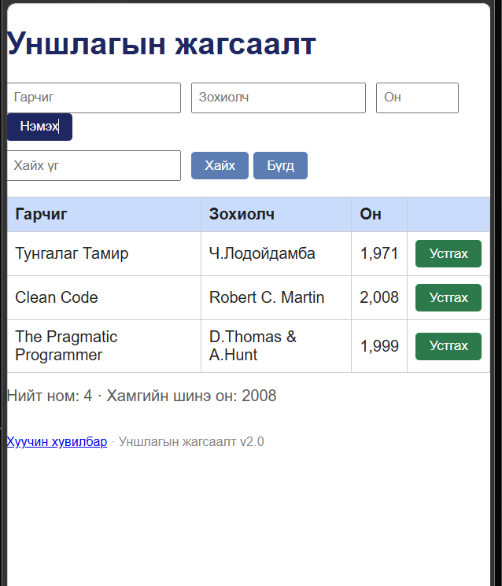
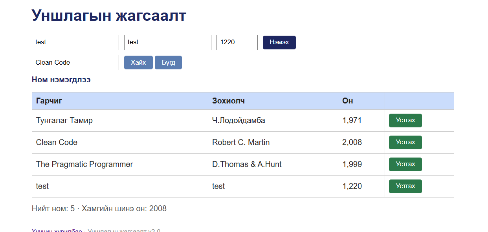

# BUG-01: Нийт номын тоолуур хүснэгтийн бодит мөрийн тооноос нэгээр их байна

Орчин: Уншлагын жагсаалт v2.0; браузер: [бодит нэр, хувилбар]; үйлдлийн систем: WSL2 / [яг хувилбар]; огноо: 2026-10-20.
Урьдчилсан нөхцөл: `node app.js`-ийг зогсоож шинээр асаасан, анхны 3 номтой төлөв.

## Дахин гаргах алхам

1. `http://localhost:3000` хаягийг нээ.
2. Анхны хүснэгтэд харагдах номуудыг нэг бүрчлэн тоол.
3. Доорх «Нийт ном» тоолуурыг харьцуул.

**Хүлээгдэж байсан:** «Нийт ном» тоолуур хүснэгтэд буй 3 номтой тэнцүү буюу `3` байна.

**Бодит үр дүн:** Хүснэгтэд 3 ном харагдаж байхад `Нийт ном: 4` гэж гарсан; нэг ном нэмэхэд 4 мөртэй боловч `Нийт ном: 5` гэж харагдсан.

**Ноцтой байдал:** Minor — Өгөгдлийн хураангуй буруу, харин ном нэмэх ажиллагаа өөрөө тасраагүй.

**Хавсралт:** `screenshots/bug-01.png`, `screenshots/bug-01-after-add.png`

**Олдсон аялал:** Supermodel (GUI)

