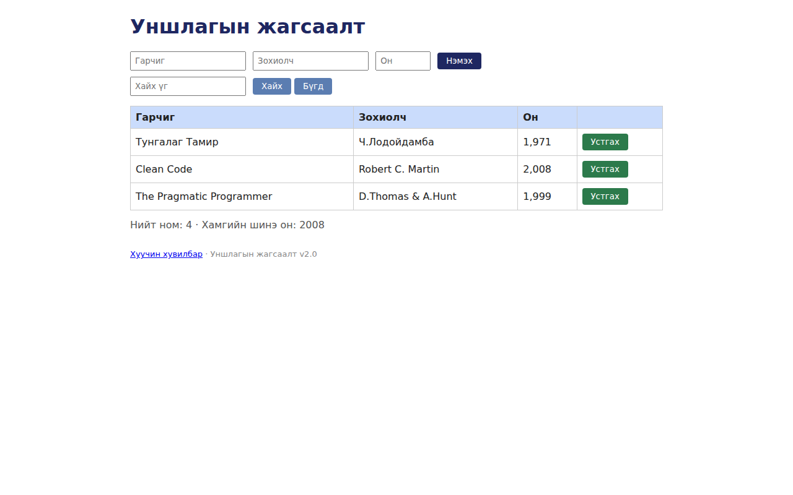
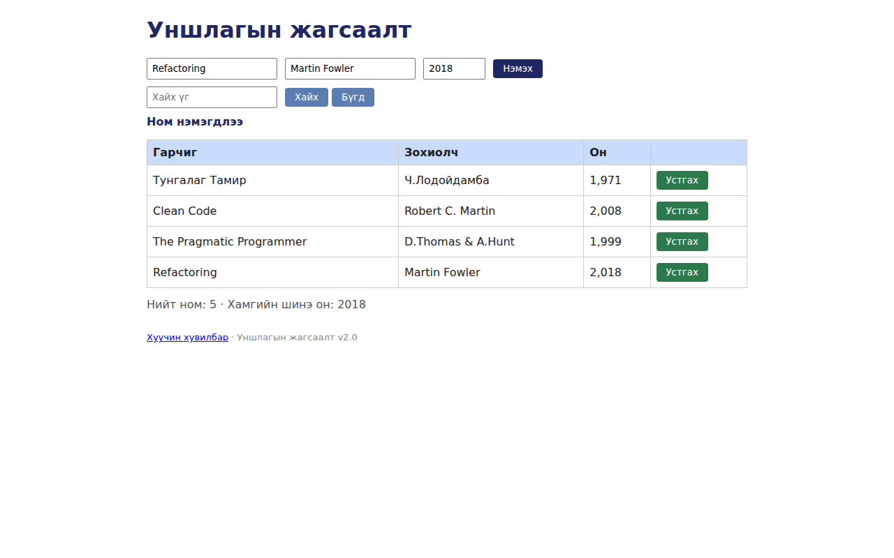

# BUG-01: Нийт номын тоолуур хүснэгтийн бодит мөрийн тооноос нэгээр их байна

Орчин: Уншлагын жагсаалт v2.0; браузер: Chromium 153.0.8010.12 (headless, Playwright 1.63.0, 1280×800); Node.js v22.23.2; үйлдлийн систем: Ubuntu 24.04.3 LTS / WSL2, Linux 6.18.54.1-microsoft-standard-WSL2; дахин шалгасан огноо: 2026-10-25 (UTC+08:00).
Урьдчилсан нөхцөл: `node app.js`-ийг зогсоож шинээр асаасан, анхны 3 номтой төлөв.

## Дахин гаргах алхам

1. `http://localhost:3000` хаягийг нээ.
2. Анхны хүснэгтэд харагдах номуудыг нэг бүрчлэн тоол.
3. Доорх «Нийт ном» тоолуурыг харьцуул.
4. Гарчиг `Refactoring`, зохиолч `Martin Fowler`, он `2018` оруулж «Нэмэx» дар.
5. Нэмэгдсэний дараах мөрийн тоо болон тоолуурыг дахин харьцуул.

**Хүлээгдэж байсан:** «Нийт ном» тоолуур хүснэгтэд буй 3 номтой тэнцүү буюу `3` байна.

**Бодит үр дүн:** Хүснэгтэд 3 ном харагдаж байхад `Нийт ном: 4` гэж гарсан; нэг ном нэмэхэд 4 мөртэй боловч `Нийт ном: 5` гэж харагдсан.

**Ноцтой байдал:** Minor — Өгөгдлийн хураангуй буруу, харин ном нэмэх ажиллагаа өөрөө тасраагүй.

**Түүхий тэмдэглэл:** [session-events.jsonl](../evidence/session-events.jsonl) — тухайн шалгалтын цаг, оролт, DOM үр дүн.

**Хавсралт:** `screenshots/bug-01.png`, `screenshots/bug-01-after-add.png`

**Олдсон аялал:** Supermodel (GUI)

