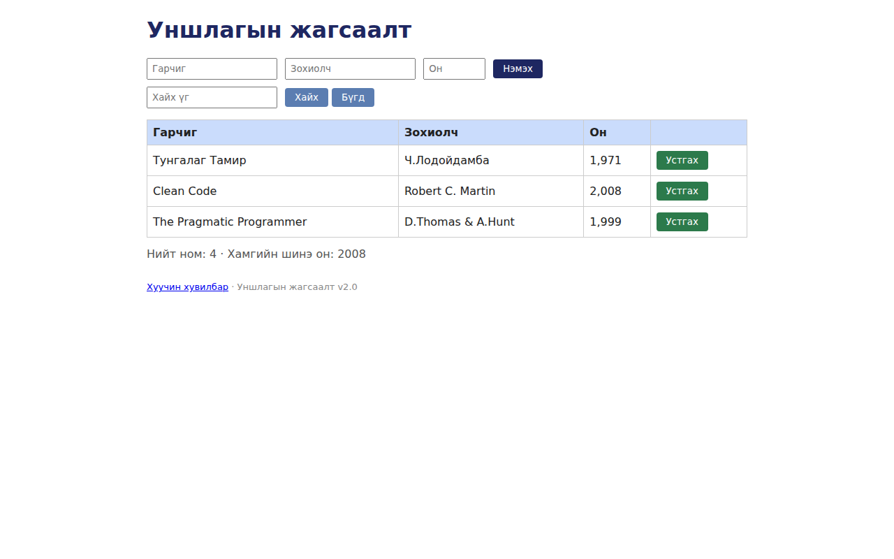

# BUG-02: Номын оныг бүхэл тоо биш, мянгатын таслалтай харуулж байна

Орчин: Уншлагын жагсаалт v2.0; браузер: Chromium 153.0.8010.12 (headless, Playwright 1.63.0, 1280×800); Node.js v22.23.2; үйлдлийн систем: Ubuntu 24.04.3 LTS / WSL2, Linux 6.18.54.1-microsoft-standard-WSL2; дахин шалгасан огноо: 2026-10-25 (UTC+08:00).
Урьдчилсан нөхцөл: `node app.js`-ийг зогсоож шинээр асаасан, анхны 3 номтой төлөв.

## Дахин гаргах алхам

1. `http://localhost:3000` хаягийг шинээр асаасан апп дээр нээ.
2. «Он» баганын анхны 3 номын утгуудыг хар.

**Хүлээгдэж байсан:** Спецификацийн дагуу оныг `1971`, `2008`, `1999` гэх мэт энгийн бүхэл тоогоор харуулна.

**Бодит үр дүн:** Он баганад `1,971`, `2,008`, `1,999` гэж мянгатын таслалтай харагдсан.

**Ноцтой байдал:** Minor — Өгөгдлийн харагдах формат спецификацид нийцээгүй.

**Түүхий тэмдэглэл:** [session-events.jsonl](../evidence/session-events.jsonl) — тухайн шалгалтын цаг, оролт, DOM үр дүн.

**Хавсралт:** `screenshots/bug-02.png`

**Олдсон аялал:** Supermodel (GUI)

