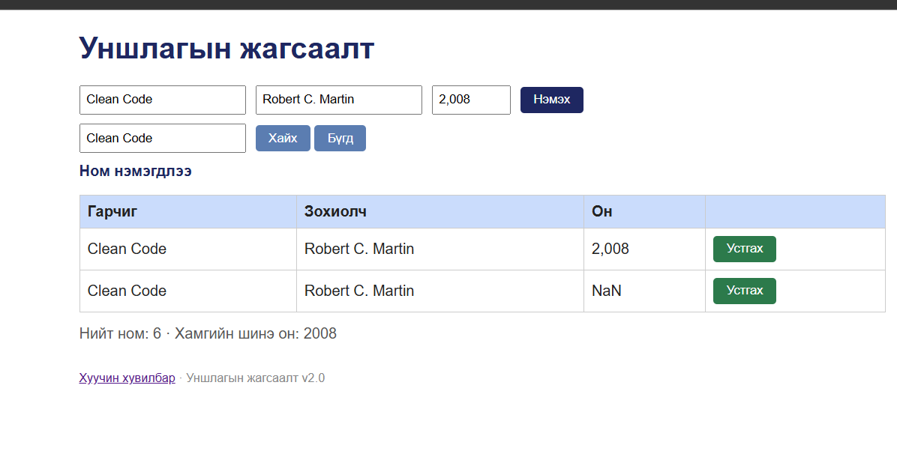

# BUG-04: «Clean Code» ном ижил гарчиг, зохиолчтойгоор давхар харагдаж байна

Орчин: Уншлагын жагсаалт v2.0; браузер: [бодит нэр, хувилбар]; үйлдлийн систем: WSL2 / [яг хувилбар]; огноо: 2026-10-20.
Урьдчилсан нөхцөл: `node app.js`-ийг зогсоож шинээр асаасан, анхны 3 номтой төлөв.

## Дахин гаргах алхам

1. `node app.js`-ийг шинээр асааж `http://localhost:3000`-ийг нээ.
2. Гарчигт `Clean Code`, зохиолчид `Robert C. Martin` гэж оруул.
3. Оны талбарт туршилтын үеийн бодит оролтыг **түүхий тэмдэглэлээсээ** оруул: `[яг бичсэн он]`.
4. «Нэмэх» товчийг дар.
5. Хайлтанд `Clean Code` гэж бичээд «Хайх» товчийг дарж үр дүнг шалга.

**Хүлээгдэж байсан:** Анхны жагсаалтад байгаа ижил гарчиг, зохиолчтой ном дахин нэмэгдэхгүй, ойлгомжтой алдааны мессеж гарна.

**Бодит үр дүн:** Илгээсэн screenshot-д `Clean Code` / `Robert C. Martin` нэртэй 2 мөр зэрэг харагдаж байна, нэг мөрийн он `NaN` байна.

**Ноцтой байдал:** Major — Давхардлыг хориглох бизнес дүрэм зөрчигдсөн байж болзошгүй.

**Хавсралт:** `screenshots/bug-04.png`

**Олдсон аялал:** Ном нэмэх GUI шалгалт (charter доторх GUI аялал)

> **Баталгаажуулалт:** Зураг нь хоёр мөрийг баталж байгаа боловч тухайн оролтын яг дарааллыг батлахгүй. `[яг бичсэн он]`-ыг өөрийн тэмдэглэлээр нөхөж, шинээр асаасан апп дээр дахин гарч байгааг шалгасны дараа л эцэслэ.
