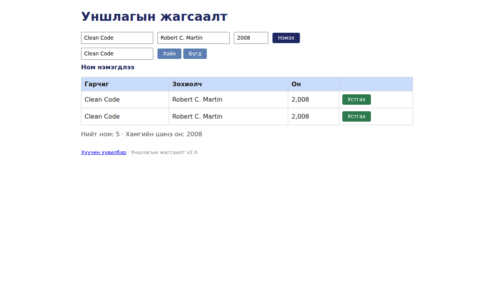

# BUG-04: «Clean Code» ном ижил гарчиг, зохиолчтойгоор давхар харагдаж байна

Орчин: Уншлагын жагсаалт v2.0; браузер: Chromium 153.0.8010.12 (headless, Playwright 1.63.0, 1280×800); Node.js v22.23.2; үйлдлийн систем: Ubuntu 24.04.3 LTS / WSL2, Linux 6.18.54.1-microsoft-standard-WSL2; дахин шалгасан огноо: 2026-10-25 (UTC+08:00).
Урьдчилсан нөхцөл: `node app.js`-ийг зогсоож шинээр асаасан, анхны 3 номтой төлөв.

## Дахин гаргах алхам

1. `node app.js`-ийг шинээр асааж `http://localhost:3000`-ийг нээ.
2. Гарчигт `Clean Code`, зохиолчид `Robert C. Martin` гэж оруул.
3. Оны талбарт `2008` гэж оруул.
4. «Нэмэх» товчийг дар.
5. Хайлтанд `Clean Code` гэж бичээд «Хайх» товчийг дарж үр дүнг шалга.

**Хүлээгдэж байсан:** Анхны жагсаалтад байгаа ижил гарчиг, зохиолчтой ном дахин нэмэгдэхгүй, ойлгомжтой алдааны мессеж гарна.

**Бодит үр дүн:** `Clean Code` / `Robert C. Martin` / `2,008` гэсэн 2 мөр хайлтын үр дүнд зэрэг харагдсан. «Ном нэмэгдлээ» мессеж гарч, давхардлын алдаа гараагүй.

**Ноцтой байдал:** Major — Ижил гарчиг, зохиолч, онтой ном давхар хадгалагдсан.

**Түүхий тэмдэглэл:** [session-events.jsonl](../evidence/session-events.jsonl) — тухайн шалгалтын цаг, оролт, DOM үр дүн.

**Хавсралт:** `screenshots/bug-04.png`

**Олдсон аялал:** Ном нэмэх GUI шалгалт (charter доторх GUI аялал)

