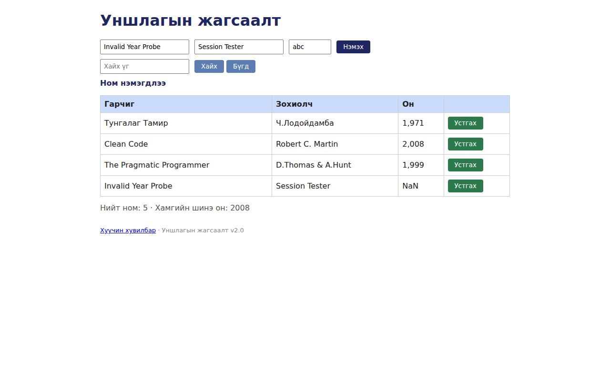

# BUG-05: Хүчингүй оны утгатай ном хүснэгтэд «NaN» гэж харагдаж байна

Орчин: Уншлагын жагсаалт v2.0; браузер: Chromium 153.0.8010.12 (headless, Playwright 1.63.0, 1280×800); Node.js v22.23.2; үйлдлийн систем: Ubuntu 24.04.3 LTS / WSL2, Linux 6.18.54.1-microsoft-standard-WSL2; дахин шалгасан огноо: 2026-10-25 (UTC+08:00).
Урьдчилсан нөхцөл: `node app.js`-ийг зогсоож шинээр асаасан, анхны 3 номтой төлөв.

## Дахин гаргах алхам

1. `node app.js`-ийг шинээр асааж `http://localhost:3000`-ийг нээ.
2. Гарчигт `Invalid Year Probe`, зохиолчид `Session Tester` гэж оруул.
3. Оны талбарт `abc` гэж оруул.
4. «Нэмэх» товчийг дар.
5. Жагсаалтад нэмэгдсэн мөрийн «Он» баганыг шалга.

**Хүлээгдэж байсан:** Он зөвхөн 1000–2100 хоорондох бүхэл тоо байна; бусад утгад ном нэмэгдэхгүй, тодорхой алдаа гарна.

**Бодит үр дүн:** `Invalid Year Probe` / `Session Tester` мөр нэмэгдэж, «Он» баганад `NaN`, мессежид «Ном нэмэгдлээ» харагдсан. Оны талбарт `abc` хэвээр харагдана.

**Ноцтой байдал:** Major — Тоо биш оны утга хадгалагдаж, хүснэгтэд буруу утга харуулсан.

**Түүхий тэмдэглэл:** [session-events.jsonl](../evidence/session-events.jsonl) — тухайн шалгалтын цаг, оролт, DOM үр дүн.

**Хавсралт:** `screenshots/bug-05.png`

**Олдсон аялал:** Ном нэмэх GUI шалгалт (charter доторх GUI аялал)

