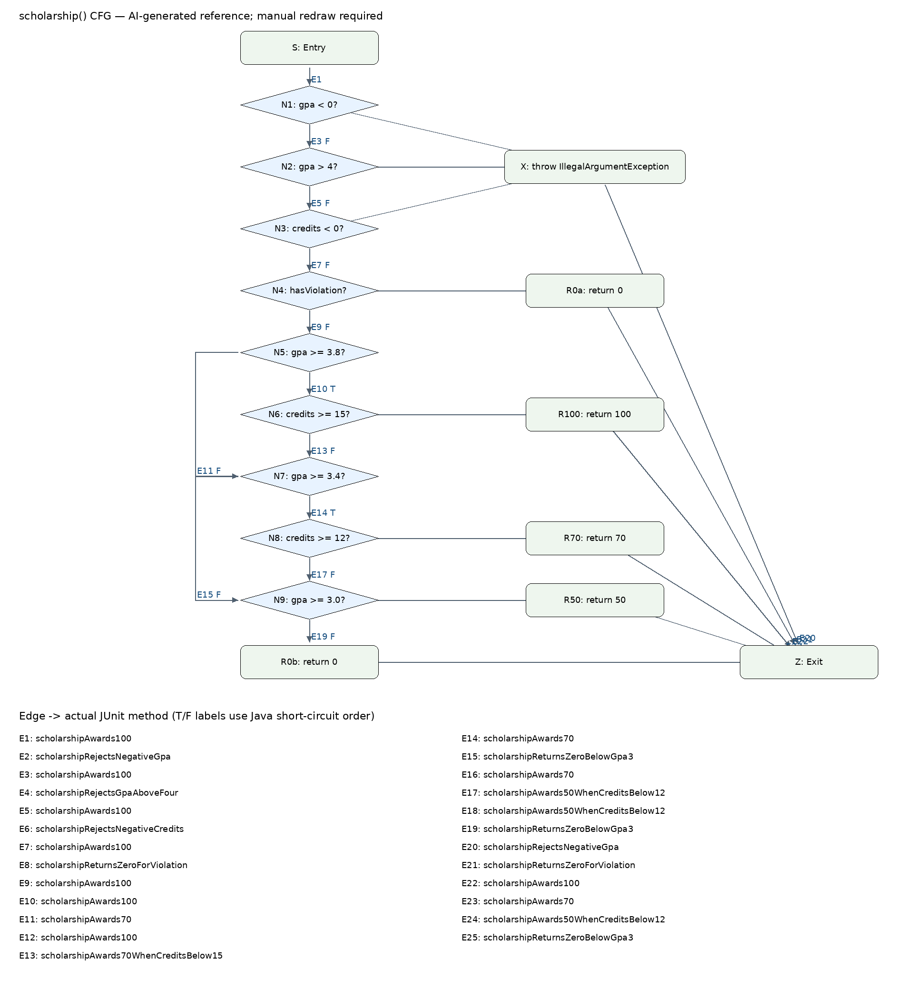

# Лаборатори 09 — JaCoCo

Нэр: С.Хишигтогтох  
Оюутны код: B232270806

## Орчин

```text
openjdk version "17.0.20.1" 2026-08-18
OpenJDK Runtime Environment (build 17.0.20.1+1-1-24.04-Ubuntu)
OpenJDK 64-Bit Server VM (build 17.0.20.1+1-1-24.04-Ubuntu, mixed mode, sharing)
Apache Maven 3.9.10 (5f519b97e944483d878815739f519b2eade0a91d)
Maven home: /mnt/c/Program Files/apache-maven-3.9.10
Java version: 17.0.20.1, vendor: Ubuntu, runtime: /usr/lib/jvm/java-17-openjdk-amd64
Default locale: en, platform encoding: UTF-8
OS name: "linux", version: "6.18.54.1-microsoft-standard-wsl2", arch: "amd64", family: "unix"
```

## Ажиллуулах

Репогийн root-оос `mvn -f lab09/starter/pom.xml verify`, эсвэл энэ хавтаснаас `mvn verify`.
HTML: `target/site/jacoco/index.html`. Java 17+, Maven, анхны dependency таталтад интернэт шаардлагатай.

## A — Happy path

5 тест. Line 60.00%, Branch 48.78%.
Хувь = covered / (missed + covered) × 100; хоёр орны нарийвчлалаар дугуйруулав.
[Лог](results/mvn-verify-A.txt), [CSV](results/jacoco-A.csv).
Хэвийн оролтын тестүүд A/B дүн, голч болон 100/70 хувийн тэтгэлгийн замыг дайрсан.
Оноо, голч, кредитийн шалгалтын exception мөрүүд хүрээгүй; эдгээрийн шалгах нөхцөлүүд дутуу салаатай.
Үлдсэн үсгэн дүн, switch case/default болон зөрчил, 50/0 хувийн тэтгэлгийн замуудыг B хэсэгт нөхнө.

## AI ашиглалт

Codex-ийг төлөвлөгөө, тест, хэмжилт, тайлбарын тусламжид ашигласан. Үр дүн нь бодит Maven ажиллуулалтын гаралт.

## B — CFG ба бүрэн хамралт

20 тест ажилласан: [лог](results/mvn-verify-B.txt), [CSV](results/jacoco-B.csv).
Line 25/25 = 100%, Branch 41/41 = 100%; LINE_MISSED=0, BRANCH_MISSED=0.
Гурван хүчингүй scholarship оролт тусдаа assertThrows тесттэй; AND нөхцөлүүдийн кредит хүрэхгүй зам, gpa switch-ийн F default хамрагдсан.



**CFG төлөв:** энэ зураг AI-аар кодоос үүсгэсэн лавлах бөгөөд зааврын «гараар зурсан» шаардлага одоогоор хангагдаагүй.
Оюутан draw.io эсвэл цаасан дээр гараар дахин зурж энэ зургийг солих шаардлагатай.
[Ирмэг–тестийн бүрэн жагсаалт](cfg-edges.json) дахь E1–E25 нэршил, true/false чиглэлийг ашиглан Лекц 9-ийн хэв маягтай тулгана.
