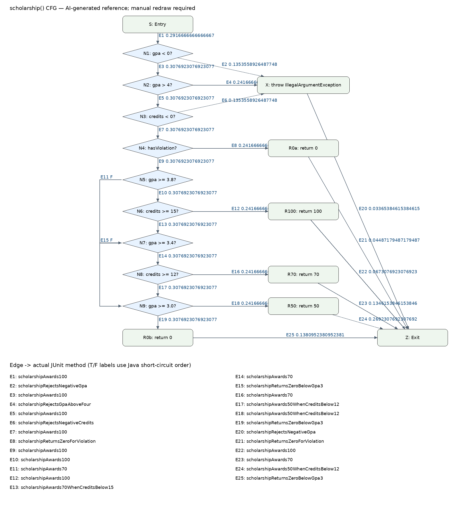

# Лаборатори 09 — JaCoCo

Нэр: С.Хишигтогтох  
Оюутны код: B232270806

## Орчин

```text
openjdk version "17.0.20.1" 2026-08-18
OpenJDK Runtime Environment (build 17.0.20.1+1-1-24.04-Ubuntu)
OpenJDK 64-Bit Server VM (build 17.0.20.1+1-1-24.04-Ubuntu, mixed mode, sharing)
Apache Maven 3.9.10 (5f519b97e944483d878815739f519b2eade0a91d)
Maven home: /mnt/c/Program Files/apache-maven-3.9.10
Java version: 17.0.20.1, vendor: Ubuntu, runtime: /usr/lib/jvm/java-17-openjdk-amd64
Default locale: en, platform encoding: UTF-8
OS name: "linux", version: "6.18.54.1-microsoft-standard-wsl2", arch: "amd64", family: "unix"
```

## Ажиллуулах

Репогийн root-оос `mvn -f lab09/starter/pom.xml verify`, эсвэл энэ хавтаснаас `mvn verify`.
HTML: `target/site/jacoco/index.html`. Java 17+, Maven, анхны dependency таталтад интернэт шаардлагатай.

## A — Happy path

5 тест. Line 60.00%, Branch 48.78%.
Хувь = covered / (missed + covered) × 100; хоёр орны нарийвчлалаар дугуйруулав.
[Лог](results/mvn-verify-A.txt), [CSV](results/jacoco-A.csv).
Хэвийн оролтын тестүүд A/B дүн, голч болон 100/70 хувийн тэтгэлгийн замыг дайрсан.
Оноо, голч, кредитийн шалгалтын exception мөрүүд хүрээгүй; эдгээрийн шалгах нөхцөлүүд дутуу салаатай.
Үлдсэн үсгэн дүн, switch case/default болон зөрчил, 50/0 хувийн тэтгэлгийн замуудыг B хэсгийн тестүүдээр нөхсөн.

## AI ашиглалт

Codex-ийг төлөвлөгөө, тест, хэмжилт, README болон CFG-ийн эх загвар, ирмэг–тестийн холбоосыг боловсруулахад ашигласан. Хамралт, тестийн тоо болон алдааны мэдээллийг `results/` дахь бодит Maven гаралт, JaCoCo CSV-тэй тулгасан. CFG-г draw.io-оос PNG хэлбэрээр экспортолсон.

## B — CFG ба бүрэн хамралт

20 тест ажилласан: [лог](results/mvn-verify-B.txt), [CSV](results/jacoco-B.csv).
Line 25/25 = 100%, Branch 41/41 = 100%; LINE_MISSED=0, BRANCH_MISSED=0.
Гурван хүчингүй scholarship оролт тусдаа assertThrows тесттэй; AND нөхцөлүүдийн кредит хүрэхгүй зам, gpa switch-ийн F default хамрагдсан.



CFG-ийн S нь эхлэл, Z нь төгсгөл; N1–N9 нь нөхцөл шалгах зангилаанууд юм. T нь үнэн, F нь худал салааг тэмдэглэнэ. Эхний `||` шалгалтын гурван нөхцөл болон хоёр `&&` шалгалтын нөхцөлүүдийг Java-ийн short-circuit дарааллаар тусад нь үзүүлсэн.

E1–E25 ирмэг бүрийн хажууд тухайн замыг дайрдаг `ScholarshipCalculatorTest` классын бодит тестийн методын нэр бий. Жишээлбэл, E2-ийн `scholarshipRejectsNegativeGpa` нь сөрөг голчийн exception замыг, E13-ийн `scholarshipAwards70WhenCreditsBelow15` нь голч хүрсэн ч 15 кредит хүрэхгүй замыг шалгана. X нь exception, R0a/R0b, R50, R70, R100 нь буцаах утгуудыг харуулна.

[Засварлах draw.io файл](scholarship-cfg.drawio) · [Ирмэг–тестийн бүрэн жагсаалт](cfg-edges.json)

## C — Давталтын зааг

22 тест ногоон: [лог](results/mvn-verify-C.txt), [CSV](results/jacoco-C.csv).
0 ангилал: `gpaRejectsNullScores`, `gpaRejectsEmptyScores` тус бүр assertThrows ашиглана.
1 ангилал: `gpaHandlesSingleScore` нь [95] → 4.0.
2+ ангилал: `gpaHandlesMultipleScores` нь [95,85,75,65] → 2.5.
Хамралт 100% байсан ч энэ нь давталтын бүх уртад тооцоо зөв гэдгийг батлахгүй.
Эдгээр тест хоосон оролтын гэрээ, нэг элементийн тооцоо, олон элементийн хуримтлал ба хуваалтыг тус тус шалгадаг учраас хэрэгтэй.

## D — Зааг утгын алдаа

[Унасан лог](results/mvn-test-D-fail.txt): 29 тестээс 1 унасан.

```text
ScholarshipCalculatorTest.letterGradeReturnsDAt60:31 expected: <D> but was: <F>
```

Тусдаа [засварын commit: 155cff1](https://github.com/khishigtogtkh/F.CSA313/commit/155cff1) нь `score > 60` нөхцөлийг `score >= 60` болгосон.
[Эцсийн лог](results/mvn-verify-final.txt): Tests run: 29, Failures: 0, Errors: 0, Skipped: 0; BUILD SUCCESS.
[Эцсийн CSV](results/jacoco-final.csv): Line 25/25 = 100%, Branch 41/41 = 100%; LINE_MISSED=0, BRANCH_MISSED=0.

### Гол дүгнэлт

B хэсгийн тестүүд бүх салааг дайрсан боловч яг 60 онооны хүлээгдэх үр дүнг шалгаагүй.
`score > 60` ба `score >= 60` нь ижил салааны бүтэцтэй тул branch хамралт дангаараа энэ ялгааг харуулахгүй.
Зааг утгын тест спецификацийн 60 оноо D байх дүрэмтэй үр дүнг харьцуулж алдааг илрүүлсэн.
JaCoCo нь тест ажиллахад кодын ямар мөр, салаа гүйцэтгэгдсэнийг хэмждэг.

