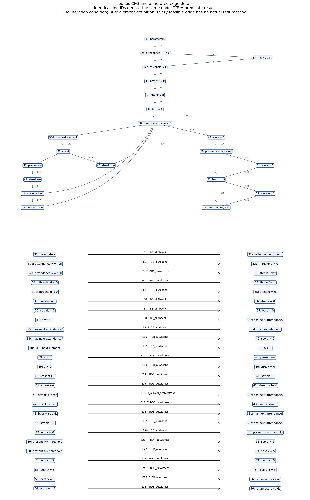

# Lab10 — Өгөгдлийн урсгалын тест

Нэр: С.Хишигтогтох  
Оюутны код: B232270806

## Орчин

```text
openjdk version "17.0.21.0.3" 2026-10-24
OpenJDK Runtime Environment (build 17.0.21.0.3+1-1-24.04.1-Ubuntu)
OpenJDK 64-Bit Server VM (build 17.0.21.0.3+1-1-24.04.1-Ubuntu, mixed mode, sharing)
Apache Maven 3.9.10 (5f519b97e944483d878815739f519b2eade0a91d)
Maven home: /mnt/c/Program Files/apache-maven-3.9.10
Java version: 17.0.21.0.3, vendor: Ubuntu, runtime: /usr/lib/jvm/java-17-openjdk-amd64
Default locale: en, platform encoding: UTF-8
OS name: "linux", version: "6.18.58.1-microsoft-standard-wsl2", arch: "amd64", family: "unix"
```

## Ажиллуулах

Энэ хавтаснаас `mvn clean verify` ажиллуулна. Java 17, JUnit Jupiter 5.10.2, JaCoCo 0.8.12 ашиглана. Нийтийн API өөрчлөөгүй. Maven Compiler Plugin 3.13.0-ийг тодорхой болгосон. Starter commit: `d409a06`; эх кодын мөрүүд хэвээр.

## A — gcd

13: def x,y; 14: tmp declaration (утга оноогоогүй тул def биш); 15: p-use y; 16: c-use x,y, def tmp; 17: c-use y, def x; 18: c-use tmp, def y; 20: c-use x.

| Variable | Def | Use | Kind | Def-clear path | Test ID | Covered |
|---|---|---|---|---|---|---|
| x | 13 | 16 | c | 13→15T→16 | gcdTwoIterations_13_15_16_17_18_20 | Yes |
| x | 13 | 20 | c | 13→15F→20 | gcdZeroY_13to20 | Yes |
| x | 17 | 16 | c | 17→18→15T→16 | gcdTwoIterations_13_15_16_17_18_20 | Yes |
| x | 17 | 20 | c | 17→18→15F→20 | gcdTwoIterations_13_15_16_17_18_20 | Yes |
| y | 13 | 15 | p-T/F | 13→15 | gcdTwoIterations_13_15_16_17_18_20; gcdZeroY_13to20 | Yes |
| y | 13 | 16 | c | 13→15T→16 | gcdTwoIterations_13_15_16_17_18_20 | Yes |
| y | 13 | 17 | c | 13→15T→16→17 | gcdTwoIterations_13_15_16_17_18_20 | Yes |
| y | 18 | 15 | p-T/F | 18→15 | gcdTwoIterations_13_15_16_17_18_20 | Yes |
| y | 18 | 16 | c | 18→15T→16 | gcdTwoIterations_13_15_16_17_18_20 | Yes |
| y | 18 | 17 | c | 18→15T→16→17 | gcdTwoIterations_13_15_16_17_18_20 | Yes |
| tmp | 16 | 18 | c | 16→17→18 | gcdTwoIterations_13_15_16_17_18_20 | Yes |

11 мөр буюу p-use салаагаар салгавал 13 шаардлага байна. gcd(7,0) нь x13→20 хосыг эдгээр тестээс ганцаараа хамарна. gcd(12,8) хоёр удаа давтаж, (12,8)→(8,4)→(4,0) болно; x17→16, y18→16/17 нь дараагийн давталт шаарддаг. gcd(0,5)=5 нэмэлт хил зааг.

## B — bonus



CFG-ийн дээд хэсэг нь холбогдсон граф, доод хэсэг нь E дугаараар ирмэг бүрийн тестийг дэлгэсэн дүрслэл: ижил мөрийн ID-тай зангилаанууд нэг зангилаа. Сум бүр дээр T/F ба бодит тестийн метод байна; 56 болон 33 нь төгсгөл. 38c/38d нь хоёулаа эх кодын 38-р мөр, 32a/32b нь 32-р мөрийн short-circuit хоёр шалгалт.

### B2 — Def/use

| Мөр | Def | c-use | p-use |
|---|---|---|---|
|31|attendance, threshold|—|—|
|32a / 32b|—|—|attendance / threshold|
|35|present|—|—|
|36|streak|—|—|
|37|best|—|—|
|38c / 38d|a (38d)|—|attendance (38c)|
|39|—|—|a|
|40|present|present|—|
|41|streak|streak|—|
|42|—|—|streak, best|
|43|best|streak|—|
|46|streak|—|—|
|49|score|—|—|
|50|—|—|present, threshold|
|51|score|—|—|
|53|—|—|best|
|54|score|score|—|
|56|—|score|—|

33-р мөр хувьсагчийн def/use агуулаагүй exception exit. Бусад хаалт, тайлбарын мөрүүд def/use биш. Array iterator-ийн далд JVM хувьсагчдыг эх кодын DU хүснэгтэд оруулаагүй.

### B3 — DU хүснэгт

Доорх 33 шаардлагад p-use-ийн T/F салааг тусад нь тоолов. RHS use нь шинэ definition-ээс өмнө: present40→40, streak41→41 нь өөр давталт хоорондын хос. Замын эхний мөр дэх def-ээс сүүлийн мөр дэх use хүртэл тухайн хувьсагч дахин тодорхойлогдоогүй.

| Variable | Def | Use | Kind | Def-clear witness | Test IDs | Covered |
|---|---|---|---|---|---|---|
| a | 38d | 39 | p-F | 38d → 39 | BD1_allDefs_score49to54, BD2_allDefs_score51to56, BB_negativeMeansAbsent, BM2_separatedRuns_doNotEarnStreakBonus, BB_allAbsent | Yes |
| a | 38d | 39 | p-T | 38d → 39 | BD1_allDefs_score49to54, BD2_allDefs_score51to56, BD5_duWitness, BB_longerThanFive, BB_negativeMeansAbsent, BM2_separatedRuns_doNotEarnStreakBonus | Yes |
| attendance | 31 | 32a | p-F | 31 → 32a | BD1_allDefs_score49to54, BD2_allDefs_score51to56, BD3_duWitness, BD4_duWitness, BD5_duWitness, BD7_duWitness, BB_longerThanFive, BB_negativeMeansAbsent, BM2_separatedRuns_doNotEarnStreakBonus, BB_allAbsent | Yes |
| attendance | 31 | 32a | p-T | 31 → 32a | BD6_duWitness, BX_nullAndNegative | Yes |
| attendance | 31 | 38c | p-F | 31 → 32a → 32b → 35 → 36 → 37 → 38c | BD3_duWitness, BD4_duWitness, BB_allAbsent, BD2_allDefs_score51to56, BB_negativeMeansAbsent, BD5_duWitness, BB_longerThanFive, BD1_allDefs_score49to54, BM2_separatedRuns_doNotEarnStreakBonus | Yes |
| attendance | 31 | 38c | p-T | 31 → 32a → 32b → 35 → 36 → 37 → 38c | BD1_allDefs_score49to54, BD2_allDefs_score51to56, BD5_duWitness, BB_longerThanFive, BB_negativeMeansAbsent, BM2_separatedRuns_doNotEarnStreakBonus, BB_allAbsent | Yes |
| best | 37 | 42 | p-T | 37 → 38c → 38d → 39 → 40 → 41 → 42 | BD1_allDefs_score49to54, BD5_duWitness, BB_longerThanFive, BM2_separatedRuns_doNotEarnStreakBonus, BD2_allDefs_score51to56, BB_negativeMeansAbsent | Yes |
| best | 37 | 53 | p-F | 37 → 38c → 49 → 50 → 53 | BD3_duWitness, BD4_duWitness, BB_allAbsent | Yes |
| best | 43 | 42 | p-F | 43 → 38c → 38d → 39 → 46 → 38c → 38d → 39 → 40 → 41 → 42 | BD1_allDefs_score49to54, BM2_separatedRuns_doNotEarnStreakBonus | Yes |
| best | 43 | 42 | p-T | 43 → 38c → 38d → 39 → 40 → 41 → 42 | BD1_allDefs_score49to54, BD5_duWitness, BB_longerThanFive, BM2_separatedRuns_doNotEarnStreakBonus | Yes |
| best | 43 | 53 | p-F | 43 → 38c → 49 → 50 → 53 | BM2_separatedRuns_doNotEarnStreakBonus, BD2_allDefs_score51to56, BB_negativeMeansAbsent | Yes |
| best | 43 | 53 | p-T | 43 → 38c → 49 → 50 → 51 → 53 | BD5_duWitness, BB_longerThanFive, BD1_allDefs_score49to54 | Yes |
| present | 35 | 40 | c | 35 → 36 → 37 → 38c → 38d → 39 → 40 | BD1_allDefs_score49to54, BD5_duWitness, BB_longerThanFive, BM2_separatedRuns_doNotEarnStreakBonus, BD2_allDefs_score51to56, BB_negativeMeansAbsent | Yes |
| present | 35 | 50 | p-F | 35 → 36 → 37 → 38c → 49 → 50 | BD3_duWitness, BB_allAbsent | Yes |
| present | 35 | 50 | p-T | 35 → 36 → 37 → 38c → 49 → 50 | BD4_duWitness | Yes |
| present | 40 | 40 | c | 40 → 41 → 42 → 38c → 38d → 39 → 40 | BM2_separatedRuns_doNotEarnStreakBonus, BD1_allDefs_score49to54, BD5_duWitness, BB_longerThanFive | Yes |
| present | 40 | 50 | p-F | 40 → 41 → 42 → 38c → 49 → 50 | BD1_allDefs_score49to54, BM2_separatedRuns_doNotEarnStreakBonus | Yes |
| present | 40 | 50 | p-T | 40 → 41 → 42 → 43 → 38c → 49 → 50 | BD2_allDefs_score51to56, BD5_duWitness, BB_longerThanFive, BB_negativeMeansAbsent | Yes |
| score | 49 | 54 | c | 49 → 50 → 53 → 54 | BD1_allDefs_score49to54 | Yes |
| score | 49 | 56 | c | 49 → 50 → 53 → 56 | BD3_duWitness, BM2_separatedRuns_doNotEarnStreakBonus, BB_allAbsent | Yes |
| score | 51 | 54 | c | 51 → 53 → 54 | BD5_duWitness, BB_longerThanFive | Yes |
| score | 51 | 56 | c | 51 → 53 → 56 | BD2_allDefs_score51to56, BD4_duWitness, BB_negativeMeansAbsent | Yes |
| score | 54 | 56 | c | 54 → 56 | BD1_allDefs_score49to54, BD5_duWitness, BB_longerThanFive | Yes |
| streak | 36 | 41 | c | 36 → 37 → 38c → 38d → 39 → 40 → 41 | BD1_allDefs_score49to54, BD5_duWitness, BB_longerThanFive, BM2_separatedRuns_doNotEarnStreakBonus | Yes |
| streak | 41 | 41 | c | 41 → 42 → 38c → 38d → 39 → 40 → 41 | BM2_separatedRuns_doNotEarnStreakBonus, BD1_allDefs_score49to54, BD5_duWitness, BB_longerThanFive | Yes |
| streak | 41 | 42 | p-F | 41 → 42 | BD1_allDefs_score49to54, BM2_separatedRuns_doNotEarnStreakBonus | Yes |
| streak | 41 | 42 | p-T | 41 → 42 | BD1_allDefs_score49to54, BD2_allDefs_score51to56, BD5_duWitness, BB_longerThanFive, BB_negativeMeansAbsent, BM2_separatedRuns_doNotEarnStreakBonus | Yes |
| streak | 41 | 43 | c | 41 → 42 → 43 | BD1_allDefs_score49to54, BD2_allDefs_score51to56, BD5_duWitness, BB_longerThanFive, BB_negativeMeansAbsent, BM2_separatedRuns_doNotEarnStreakBonus | Yes |
| streak | 46 | 41 | c | 46 → 38c → 38d → 39 → 40 → 41 | BD1_allDefs_score49to54, BD2_allDefs_score51to56, BB_negativeMeansAbsent, BM2_separatedRuns_doNotEarnStreakBonus | Yes |
| threshold | 31 | 32b | p-F | 31 → 32a → 32b | BD1_allDefs_score49to54, BD2_allDefs_score51to56, BD3_duWitness, BD4_duWitness, BD5_duWitness, BB_longerThanFive, BB_negativeMeansAbsent, BM2_separatedRuns_doNotEarnStreakBonus, BB_allAbsent | Yes |
| threshold | 31 | 32b | p-T | 31 → 32a → 32b | BD7_duWitness | Yes |
| threshold | 31 | 50 | p-F | 31 → 32a → 32b → 35 → 36 → 37 → 38c → 49 → 50 | BD3_duWitness, BB_allAbsent, BD1_allDefs_score49to54, BM2_separatedRuns_doNotEarnStreakBonus | Yes |
| threshold | 31 | 50 | p-T | 31 → 32a → 32b → 35 → 36 → 37 → 38c → 49 → 50 | BD4_duWitness, BD2_allDefs_score51to56, BB_negativeMeansAbsent, BD5_duWitness, BB_longerThanFive | Yes |

**Kill ба боломжгүй зам.** 46 нь streak-ийн 36, 41 эсвэл өмнөх давталтын 46 definition-ийг kill хийнэ. 36→…46→41, 41→…46→41 нь def-clear биш; харин шинэ 46→41 нь хүчинтэй. 36/46→42 эсвэл →43 нь дундах 41 definition-ээр заавал тасарна. best37→42F биелэхгүй: анхны ирсэн өдөр streak=1, best=0 тул true. best37→53T биелэхгүй: 43 ажиллаагүй бол best=0. score49→…51→54/56 нь kill-тэй учир 49-ийн DU зам биш. threshold31→50 нь зөвхөн 32bF дараа боломжтой; attendance=null үед 32b болон 50 хүрэхгүй. Бусад хүснэгтэд орсон p-use салаа бүр бодит witness-тэй.

Статик шалгалт: хувьсагч бүрийн бүх def-ээс CFG дагуу явж дараагийн def дээр зогсоход дээрх use цэгүүд л үлдэнэ; best-ийн хоёр боломжгүй салааг хасна. `analysis/du_analysis.py` нь энэ анализын witness шалгах туслах загвар: 0/1 массивын урт 0–8, threshold 0/n/n+1 болон invalid оролтуудыг судалсан. Хязгаартай enumeration дангаараа бүрэн байдлын баталгаа биш. Оролтын >0 ангилал, давталтын back-edge, definition kill-ийг эх кодтой тулгаж дүгнэсэн. Хүлээгдэх оноо нь JUnit файлд тогтмол assertion болсон.

### B4 — all-defs → all-DU-pairs

BD1, BD2 хоёр bonus тест хамгийн бага all-defs багц. BD1 нь 35/36/37/40/41/43/46/49/54 definition-үүдийг use-д хүргэнэ; BD2 нь 51-ийг 56-д хүргэнэ. attendance, threshold, a мөн use-тэй. Нэг тестэд score49-ийн use ба score51-ийн def-ийг хамруулж болохгүй: 50T үед 51 нь 49-ийг use-ээс өмнө kill хийнэ. Иймээс доод хязгаар 2, сонгосон багц түүнд хүрсэн. Gcd-ийн 3 тест нэмэгдэж all-defs log нийт 5 тесттэй.

All-DU шатны багц 10 bonus + 3 gcd = 13 тест; C-ийн дараа M2-kill, all-absent нэмэгдэж 15 болно. BD3 хоосон threshold1→0; BD4 хоосон threshold0→5; BD5 таван ирц threshold0→8; BD6/BD7 invalid оролт. BB тестүүд урт цуваа, сөрөг attendance ба бүгд тасалсан нөхцөлийг шалгана.

### B5 — JaCoCo

- `jacoco-alldefs.csv`: Branch 14/16, missed 2; Line 22/24, missed 2.
- `jacoco-final.csv`: Branch 16/16, missed 0; Line 23/24, missed 1.

All-defs нь branch 100% шаардахгүй: exception-ийн салаанууд эхний багцад дутуу. Эцсийн нэг missed line нь 7-р мөрийн далд constructor; түүнийг зориуд тестлээгүй. Branch 100% нь бүх DU хосыг батлахгүй: BD1, BD2 ба null/negative exception тестүүд бүх салааг хамарч чадна, гэхдээ score49→56 болон score51→54 хосууд дутуу; BD3 ба BD5 тэдгээрийг тус тус нөхнө. Энэ нь branch-ийн тусдаа T/F гүйцэтгэлүүд definition-ээс use хүрэх бүх шаардлагыг орлохгүйг харуулна.

## C — Fault seeding

| Mutation | Бодит үр дүн | Нотолгоо |
|---|---|---|
| M1 | [ERROR]   BonusTest.BB_longerThanFive:13 expected: <8> but was: <5>; [ERROR]   BonusTest.BD1_allDefs_score49to54:5 expected: <3> but was: <0>; [ERROR]   BonusTest.BD5_duWitness:9 expected: <8> but was: <5> | results/mvn-test-M1.txt |
| M2 | BUILD SUCCESS; бүх тест ногоон | results/mvn-test-M2.txt |
| M3 | BUILD SUCCESS; бүх тест ногоон | results/mvn-test-M3.txt |
| M2-kill | [ERROR]   BonusTest.BM2_separatedRuns_doNotEarnStreakBonus:15 expected: <0> but was: <3> | results/mvn-test-M2-kill.txt |

M2 эхний 13 тестийг давсан: best шинэчлэгдсэн мөчүүдэд present=streak байсан; тасралтын дараах богино цуваанд streak>best худал тул буруу оноолт ажиллаагүй. BM2 тестийн [1,1,1,0,1,1,1,1] дээр present=7, longest streak=4; threshold=8 тул зөв оноо 0. Мутантын сүүлийн шинэчлэлт best=7 болгож буруу 3 оноо өгнө. Нэмэлт багцын 15 тестээр M2-г унагасан.

M3 нь return болон төлөвийг өөрчлөхгүй тул тест унахгүй, javac ердийн тохиргоогоор unused local анхааруулдаггүй. Eclipse JDT ECJ 3.40.0-ийг `-17 -proc:none -warn:+unusedLocal` тохиргоогоор ажиллуулахад дараах бодит static diagnostic гарсан (`results/m3-static-analysis.txt`):

```text
The value of the local variable total is not used
```

Энэ нь IDE-ийн screenshot биш, Eclipse compiler-ийн command-line static diagnostic. ECJ jar нь /tmp-д байрласан, төсөлд dependency нэмээгүй. Мутаци бүрийн дараа starter-ийн яг ижил агуулгыг сэргээсэн; эцэст Git restore ба Starter diff-ээр давхар шалгасан. Мутацийн source commit хийгээгүй.

## Нэмэлт — AI хүснэгтийн харьцуулалт

Анхны хүснэгт `analysis/baseline-du.md`, дараах review `analysis/ai-review.md`-д бий. Хоёул Codex тусламжтай хийгдсэн тул хүний бие даасан анализтай хараат бус AI харьцуулалт гэж үзэхгүй. Давтан review нь анхны хүснэгтийн 33 боломжит салаат шаардлагыг баталсан. best37→42F болон best37→53T-г боломжтой гэж нэмэх нь буруу болохыг invariant-аар шийдсэн. streak36/46→42/43-г шууд хос болгох нь 41-ийн kill-ийг алдах болно. 38-ийн condition ба element definition-ийг салгах нь attendance ба a-ийн үүргийг тодруулсан. Суурь хүснэгтээс хүчинтэй хос дутсан эсвэл илүү орсон зөрүү илрээгүй; M2-ийн шинэ тест нь шинэ DU хос нэмэлгүйгээр утгын ялгааг барьсан.

## Дүгнэлт

DU анализ хувьсагчийн тодорхой утга хаана үүсээд хаана хэрэглэгдсэнийг хянадаг. Branch хамралт зөвхөн шийдвэрийн хоёр үр дүнг хэмждэг. Хоёр all-defs тест definition-үүдийг use-д хүргэсэн ч зарим DU хос үлдсэн. Def-clear зам ба kill-ийг шалгах нь хүснэгт бэлтгэх ажлын хамгийн их хөдөлмөр шаардсан хэсэг байв. M1 дутуу шинэчлэлтийг тестүүд барьсан. M2 бүх DU хос хамрагдсан ч утгын ялгааг мэдрэх assertion оролт хэрэгтэйг харуулсан. M3 dead definition-д static analysis шаардлагатайг баталсан. Иймээс DU, branch, утгын assertion болон static analysis-ийг хамтатган ашиглах нь илүү өргөн нотолгоо өгнө.

## AI ба баталгаажуулалтын хүрээ

Codex нь төлөвлөлт, DU анализ, witness загвар, тест, CFG, мутацийн ажиллуулалт ба тайланд оролцсон. Хүний дангаар хийсэн ажил гэж тайлагнахгүй. Local Maven үр дүнг results-д хадгалсан; GitHub push, public/default branch, Teams Turn in хийгээгүй. Parent F.CSA313 репог ашигласан нь local хүрээний сонголт; багшийн тусдаа root репозиторийн submission шаардлагыг одоогоор гүйцэтгэсэн гэж үзэхгүй.

