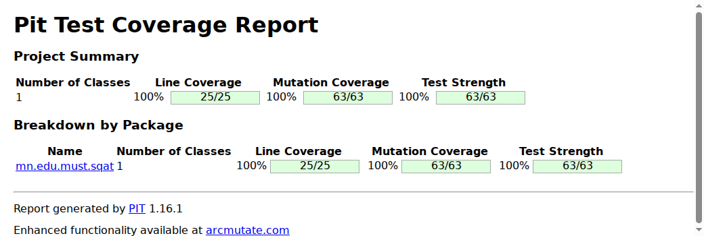

# Лабораторийн тайлан №11 — PIT ашиглан тестийн чанарыг хэмжих

**Хичээл** — F.CSA313 Программ хангамжийн чанарын баталгаа ба тест

**Овог нэр** — С.Хишигтогтох

**Оюутны код** — B232270806

## Зорилго ба туршилтын орчин

Лабораторийн ажлаар тэтгэлэг тооцоологчийн бүх мөрийг хамарсан тестийн багц алдааг хэр сайн илрүүлэхийг судалсан. `ScholarshipCalculator` нь оноог үсгэн дүнд хөрвүүлж, дүнгийн голч бодож, голч болон кредитээр тэтгэлгийн хувь тогтоодог. Эхний JUnit 5 багцын хамралтыг JaCoCo-оор хэмжээд, PIT-ийн `STRONGER` тохиргоогоор үүсгэсэн мутантуудаас хэдийг нь тест илрүүлж байгааг харьцуулсан. Буцах утгын шалгалт болон заагийн оролтыг хоёр тусдаа үе шатанд сайжруулж, тус бүрийн дараа хэмжилтийг давтсан.

Хэмжилтийг Ubuntu WSL2 дээр хийсэн. Төслийн хавтсаас авсан хувилбарын гаралт дараах байдалтай байв.

### `java -version`

```text
openjdk version "17.0.21.1" 2026-11-17
OpenJDK Runtime Environment (build 17.0.21.1+2-1-24.04.1-Ubuntu)
OpenJDK 64-Bit Server VM (build 17.0.21.1+2-1-24.04.1-Ubuntu, mixed mode, sharing)
```

### `mvn -version`

```text
Apache Maven 3.9.10 (5f519b97e944483d878815739f519b2eade0a91d)
Maven home: /mnt/c/Program Files/apache-maven-3.9.10
Java version: 17.0.21.1, vendor: Ubuntu, runtime: /usr/lib/jvm/java-17-openjdk-amd64
Default locale: en, platform encoding: UTF-8
OS name: "linux", version: "6.18.58.1-microsoft-standard-wsl2", arch: "amd64", family: "unix"
```

## Эхний хэмжилт

`mvn clean verify` ажиллуулахад өгөгдсөн зургаан тест бүгд амжилттай болсон. JaCoCo тайланд **25/25 мөр (100%), 38/41 салаа (92%)** хамрагдсан байв. Дараа нь `mvn test-compile org.pitest:pitest-maven:mutationCoverage` тушаалаар PIT хэмжихэд **63 мутантаас 17 (27%)** нь илэрч, 46 нь амьд үлдсэн.

95 оноо өгөхөд анхны тест `letterGrade()`-ийн буцаасан утгыг `assertNotNull`-аар шалгаж байв. PIT `"A"`-г хоосон мөрөөр солиход тэр шалгалт тэнцсэн хэвээр байлаа. Иймээс 100%-ийн мөрийн хамралт нь тухайн мөр ажилласныг харуулж байгаа бол 27%-ийн mutation coverage нь анхны шалгалтууд буруу үр дүнг хэр цөөн илрүүлснийг харуулж байна.


[Maven verify гаралт](results/mvn-verify-start.txt) · [JaCoCo CSV](results/jacoco-start.csv) · [PIT-ийн эхний гаралт](results/pit-start.txt)

## A. Амьд үлдсэн мутантуудын шинжилгээ

PIT-ийн HTML тайланд `letterGrade()`-д 19, `gpa()`-д 4, `scholarship()`-д 23 буюу нийт **46** мутант `SURVIVED` төлөвтэй гарсан. Ангилахдаа мутаци үүссэн мөрийг эх кодтой тулгаж, ямар оролтод буцах утга эсвэл алдаа шидэх нөхцөл өөрчлөгдөхийг шалгасан. Бүх 46 мутантад ялгаа гаргах оролт олдсон тул “Тест дутуу” гэж бүртгэсэн.

| Кодын мөр | PIT-ийн тайлбар ба нөлөөлсөн хэсэг | Тоо | Ангилал | Үндэслэл ба авах арга хэмжээ |
| --- | --- | ---: | --- | --- |
| 20 | `changed conditional boundary`, доод ба дээд хязгаар | 2 | Тест дутуу | Заагийн мутаци хүчинтэй 0 эсвэл 100 дээр exception үүсгэх тул B2-д 0 → F, 100 → A гэж шалгасан. |
| 23 | `changed conditional boundary`, 90 | 1 | Тест дутуу | 90 оноо A-аас B болж өөрчлөгдөх тул B2-д 90 → A гэж шалгасан. |
| 23 | `removed conditional - replaced comparison check with true` / `false` | 2 | Тест дутуу | A салааг албадвал 85 дээр A, алгасвал 95 дээр B буцах тул B1-д 85 → B, 95 → A гэж шалгасан. |
| 23 | `replaced return value with ""`, A | 1 | Тест дутуу | 95 дээр хоосон мөр буцахад starter-ийн `assertNotNull` амжилттай өнгөрөх тул B1-д 95 → A гэж шалгасан. |
| 24 | `changed conditional boundary`, 80 | 1 | Тест дутуу | 80 оноо B-ээс C болж өөрчлөгдөх тул B2-д 80 → B гэж шалгасан. |
| 24 | `removed conditional - replaced comparison check with true` / `false` | 2 | Тест дутуу | B салааг албадвал 75 дээр B, алгасвал 85 дээр C буцах тул B1-д 75 → C, 85 → B гэж шалгасан. |
| 24 | `replaced return value with ""`, B | 1 | Тест дутуу | 85 дээр хоосон мөр буцахад `assertNotNull` амжилттай өнгөрөх тул B1-д 85 → B гэж шалгасан. |
| 25 | `changed conditional boundary`, 70 | 1 | Тест дутуу | 70 оноо C-ээс D болж өөрчлөгдөх тул B2-д 70 → C гэж шалгасан. |
| 25 | `removed conditional - replaced comparison check with true` / `false` | 2 | Тест дутуу | C салааг албадвал 65 дээр C, алгасвал 75 дээр D буцах тул B1-д 65 → D, 75 → C гэж шалгасан. |
| 25 | `replaced return value with ""`, C | 1 | Тест дутуу | 75 дээр хоосон мөр буцахад `assertNotNull` амжилттай өнгөрөх тул B1-д 75 → C гэж шалгасан. |
| 26 | `changed conditional boundary`, 60 | 1 | Тест дутуу | 60 оноо D-ээс F болж өөрчлөгдөх тул B2-д 60 → D гэж шалгасан. |
| 26 | `removed conditional - replaced comparison check with true` / `false` | 2 | Тест дутуу | D салааг албадвал 30 дээр D, алгасвал 65 дээр F буцах тул B1-д 30 → F, 65 → D гэж шалгасан. |
| 26 | `replaced return value with ""`, D | 1 | Тест дутуу | 65 дээр хоосон мөр буцахад `assertNotNull` амжилттай өнгөрөх тул B1-д 65 → D гэж шалгасан. |
| 27 | `replaced return value with ""`, F | 1 | Тест дутуу | 30 дээр хоосон мөр буцахад `assertNotNull` амжилттай өнгөрөх тул B1-д 30 → F гэж шалгасан. |
| 36 | `Changed switch default to be first case` | 1 | Тест дутуу | F дүнгийн default салаа эхний салааны 4 оноог нэмэх тул B1-д `gpa([40]) → 0.0` гэж шалгасан. |
| 38 | `Replaced double addition with subtraction`, B | 1 | Тест дутуу | B-ийн 3 оноог хасвал [95, 85]-ын голч 0.5 болох тул B1-д 3.5 гэж шалгасан. |
| 40 | `Replaced double addition with subtraction`, D | 1 | Тест дутуу | D-ийн 1 оноог хасвал [75, 65]-ын голч 0.5 болох тул B1-д 1.5 гэж шалгасан. |
| 44 | `replaced double return with 0.0d` | 1 | Тест дутуу | Эерэг голч 0.0 болж өөрчлөгдөх тул B1-д [95, 85] → 3.5 гэж шалгасан. |
| 48 | `changed conditional boundary`, голч ба кредитийн доод хязгаар | 2 | Тест дутуу | Голч эсвэл кредит яг 0 байхад exception үүсэх тул B2-д (0, 12, false) → 0, (3.0, 0, false) → 50 гэж шалгасан. |
| 48 | `removed conditional - replaced comparison check with true`, сөрөг голчийн шалгалт | 1 | Тест дутуу | Сөрөг голч зөвшөөрөгдөж 0 буцах тул B2-д (−0.01, 12, false) дээр exception шалгасан. |
| 51 | `removed conditional - replaced equality check with true` / `false` | 2 | Тест дутуу | Зөрчлийн нөхцөлийг албадвал зөрчилгүй оюутанд 0, алгасвал зөрчилтэй оюутанд 100 буцах тул B1-д (3.9, 16, false) → 100, (4, 20, true) → 0 гэж шалгасан. |
| 52 | `changed conditional boundary`, 3.8 ба 15 кредит | 2 | Тест дутуу | Голч эсвэл кредитийг яг заагаар нь өгөхөд 100-аас 70 болж буурах тул B2-д (3.8, 16, false) ба (3.9, 15, false) дээр 100 шалгасан. |
| 52 | `removed conditional - replaced comparison check with true` / `false`, голч | 2 | Тест дутуу | Голчийн шалгалтыг алгасвал (3.79, 15, false) дээр 100, салааг хаавал (3.9, 16, false) дээр 70 буцах тул B2 ба B1-д харгалзан 70, 100 шалгасан. |
| 52 | `removed conditional - replaced comparison check with true` / `false`, кредит | 2 | Тест дутуу | Кредитийн шалгалтыг алгасвал (3.8, 14, false) дээр 100, салааг хаавал (3.9, 16, false) дээр 70 буцах тул B2 ба B1-д харгалзан 70, 100 шалгасан. |
| 52 | `replaced int return with 0`, 100% | 1 | Тест дутуу | 100 авах ёстой оюутанд 0 буцах тул B1-д (3.9, 16, false) → 100 гэж шалгасан. |
| 53 | `changed conditional boundary`, 3.4 ба 12 кредит | 2 | Тест дутуу | Голч эсвэл кредитийг яг заагаар нь өгөхөд 70-аас 50 болж буурах тул B2-д (3.4, 13, false) ба (3.5, 12, false) дээр 70 шалгасан. |
| 53 | `removed conditional - replaced comparison check with true` / `false`, голч | 2 | Тест дутуу | Голчийн шалгалтыг алгасвал (3.39, 12, false) дээр 70, салааг хаавал (3.5, 13, false) дээр 50 буцах тул B2 ба B1-д харгалзан 50, 70 шалгасан. |
| 53 | `removed conditional - replaced comparison check with true` / `false`, кредит | 2 | Тест дутуу | Кредитийн шалгалтыг алгасвал (3.4, 11, false) дээр 70, салааг хаавал (3.5, 13, false) дээр 50 буцах тул B2 ба B1-д харгалзан 50, 70 шалгасан. |
| 53 | `replaced int return with 0`, 70% | 1 | Тест дутуу | 70 авах ёстой оюутанд 0 буцах тул B1-д (3.5, 13, false) → 70 гэж шалгасан. |
| 54 | `changed conditional boundary`, 3.0 | 1 | Тест дутуу | Яг 3.0 голчтой оюутанд 0 буцах тул B2-д (3.0, 0, false) → 50 гэж шалгасан. |
| 54 | `removed conditional - replaced comparison check with true` / `false` | 2 | Тест дутуу | 50%-ийн салааг албадвал (2.0, 1, false) дээр 50, алгасвал (3.1, 5, false) дээр 0 буцах тул B1-д харгалзан 0, 50 шалгасан. |
| 54 | `replaced int return with 0`, 50% | 1 | Тест дутуу | 50 авах ёстой оюутанд 0 буцах тул B1-д (3.1, 5, false) → 50 гэж шалгасан. |

## B. Тестийг сайжруулсан нь

### B1. Буцах утгыг нарийн шалгасан нь

Эхний шатанд өгөгдсөн оролтуудыг ашиглаж, `assertNotNull` болон муж шалгасан `assertTrue`-г `assertEquals`-оор сольсон. Тухайлбал, 95 оноонд `"A"`, 95 ба 85 онооны голчид `3.5`, 3.9 голчтой, 16 кредиттэй, зөрчилгүй оюутанд `100` гэсэн хүлээгдэж буй утгыг шалгасан. Үүний дараа 28 нэмэлт мутант илэрсэн. Амьд үлдсэн 18 мутантын 13 нь харьцуулалтын заагийг өөрчилж, 5 нь нөхцөлийг тогтмол утгаар сольсон байв.

### B2. Заагийн утгуудыг шалгасан нь

Хүлээгдэж буй утгыг нарийн шалгасан ч эхний багцад зааг дээрх оролт цөөн байв. Жишээ нь 95 оноонд `score >= 90` ба `score > 90` хоёр нөхцөл хоёулаа үнэн тул яг 90 оноог өгч ялгааг илрүүлэх шаардлагатай болсон. Ийм тохиолдлуудад параметртэй тест нэмж, дараах утгуудыг шалгасан.

- **Үсгэн дүн.** `90/89.99 → A/B`, `80/79.99 → B/C`, `70/69.99 → C/D`, `60/59.99 → D/F` гэсэн хосуудаар зааг бүрийг хоёр талаас нь шалгасан. Хүчинтэй мужийн төгсгөлүүдэд `0 → F`, `100 → A` гэж баталгаажуулсан.
- **Голч.** `switch`-ийн A, B, C, D, F дүн тус бүрийг `4.0, 3.0, 2.0, 1.0, 0.0` оноонд хувиргаж байгааг шалгасан. Холимог `[95, 85, 40, 75]` оролтоор голч `2.25` гарахыг шалгасан.
- **Тэтгэлэг.** Голч, кредитийн `(3.8, 15)` болон `(3.4, 12)` зааг дээр 100% ба 70% олгож, голч эсвэл кредитийн аль нэг нь хүрэлцэхгүй бол доод шатлалд шилжихийг шалгасан. Голч `3.0`, `2.99`, `0`, `4` болон кредит `0` байх тохиолдлуудыг оруулсан. Сөрөг голч, 4-өөс их голч, сөрөг кредитэд алдаа шидэхийг мөн шалгасан.

### Гурван хэмжилтийн дүн

| Үе | Үүссэн | Илрүүлсэн | Амьд | Mutation Coverage | PIT гаралт |
| --- | ---: | ---: | ---: | ---: | --- |
| Эхлэл | 63 | 17 | 46 | 27% | [pit-start.txt](results/pit-start.txt) |
| B1. Яг утгын assertion | 63 | 45 | 18 | 71% | [pit-B1.txt](results/pit-B1.txt) |
| B2. Зааг утга | 63 | 63 | 0 | 100% | [pit-B2.txt](results/pit-B2.txt) |

B1, B2 хэмжилтийн бүтэн гаралтыг `results/` дотор тус тусад нь хадгалж, өөрчлөлт бүрийг бие даасан commit-оор бүртгэсэн. B2-ын дараа үлдсэн 18 мутант бүгд илэрсэн. Ингэснээр **Mutation Coverage 100%** болж, даалгаврын 85%-ийн босгыг давсан. PIT тайланд **Test Strength 100%**, тестээр хамрагдаагүй мутант 0 гарсан.



## C. Гар мутаци

PIT ашиглалгүйгээр заагийн тестийг шалгахын тулд `scholarship()`-ийн 52-р мөрөнд `gpa >= 3.8`-ыг түр `gpa > 3.8` болгосон. `mvn test` ажиллуулахад голч нь яг 3.8 байсан хоёр кейс 100% хүлээж байхад 70% авсан. Өөрчлөгдсөн нөхцөл эдгээр кейсийг дараагийн шатлал руу шилжүүлсэн.

| Унасан тест | Оролт | Maven-ийн алдааны мөр |
| --- | --- | --- |
| `scholarship_awards100AtTopGpaAndCreditThresholds` | `(3.8, 15, false)` | `ScholarshipCalculatorTest.scholarship_awards100AtTopGpaAndCreditThresholds:87 expected: <100> but was: <70>` |
| `scholarship_appliesGpaAndCreditBoundaries`-ийн эхний кейс | `(3.8, 16, false)` | `ScholarshipCalculatorTest.scholarship_appliesGpaAndCreditBoundaries:100 expected: <100> but was: <70>` |

Туршилтын дүнгээр 37 тестээс 2-ын утгын шалгалт унасан. `git restore src/main` хийсний дараа 37 тест бүгд амжилттай болж, `src/main` Starter commit-ийн агуулгатай таарсан. [Гар мутацийн Maven гаралт](results/mvn-test-manual-mutant.txt)

**Ижил зан төлөвтэй мутантын жишээ.** Кредит бүхэл тоо учраас `credits < 0` нөхцөлийг `credits <= -1` болгосон ч хоёр нөхцөл ижил оролтуудад үнэн байна. Тиймээс ямар ч оролтод тэтгэлгийн хувь болон алдаа шидэх нөхцөл адил гарч, тестээр энэ өөрчлөлтийг ялгах боломжгүй.

## Дүгнэлт

Мөрийн хамралт тестээр кодын ямар мөрүүд ажилласныг харуулдаг. PIT-ийн mutation coverage тухайн мөрийн зан төлөв өөрчлөгдөхөд тест унаж байгааг хэмждэг. Анхны багц 25 мөрийг бүгдийг хамарсан боловч үүсгэсэн 63 мутантаас ердөө 17-г илрүүлсэн. Яг утгын шалгалтаар энэ тоо 45 болж, заагийн тест нэмсний дараа 63 хүрсэн. Гар туршилтаар яг 3.8 голчтой оюутны тэтгэлэг 100%-аас 70% болж өөрчлөгдсөн нь нэг тэмдэг солигдоход ч заагийн оролт чухал болохыг харуулсан. AI-аар бичүүлсэн тестүүд кодыг ажиллуулж чадсан ч буцах утгыг сул шалгаж болох тул mutation score болон амьд үлдсэн мутантын тайлбарыг хамт үзэх хэрэгтэй. Тест болон тайлан боловсруулахад AI ашигласан бөгөөд дурдсан дүнг төслийн бодит Maven, JaCoCo, PIT гаралттай тулгасан.

## Дахин ажиллуулж баталгаажуулах

Java 17 болон Maven-тэй орчинд репозиторийг шинэ хавтаст clone хийгээд Lab11-ийн төслөөс ажиллуулна.

```bash
git clone https://github.com/khishigtogtkh/F.CSA313.git F.CSA313-lab11-check
cd F.CSA313-lab11-check/lab11-pit
mvn clean verify
mvn test-compile org.pitest:pitest-maven:mutationCoverage
```

GitHub-аас авсан шинэ clone дээр 37 тест амжилттай болж, PIT 63/63 мутант илрүүлсэн. JaCoCo тайлан `target/site/jacoco/index.html`, PIT тайлан `target/pit-reports/index.html` замд гарна.

Git түүхээс `6a7fc30` (Starter), `ef74e6a` (эхний хэмжилт), `9c6e3fb` (A), `2d74c3e` (B1), `bcb5c1f` (B2), `3a21d18` (C) үе шатуудыг харж болно. Төслийн хавтаснаас `git diff --exit-code 6a7fc30 HEAD -- src/main` тушаалаар тооцоологчийн эх кодыг Starter хувилбартай тулгана.
