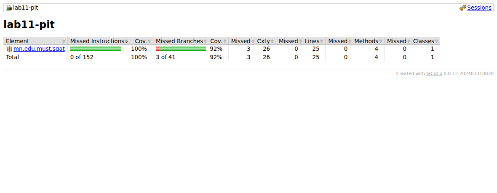

# Лаборатори №11. PIT mutation testing

Овог нэр — С.Хишигтогтох  
Оюутны код — B232270806

## Орчин

Гаралтыг `lab11-pit` төслийн хавтсаас авсан.

### `java -version`

```text
[0.015s][warning][perf,memops] Cannot use file /tmp/hsperfdata_hishigtogtokh/9 because it is locked by another process (errno = 11)
openjdk version "17.0.21.1" 2026-11-17
OpenJDK Runtime Environment (build 17.0.21.1+2-1-24.04.1-Ubuntu)
OpenJDK 64-Bit Server VM (build 17.0.21.1+2-1-24.04.1-Ubuntu, mixed mode, sharing)
```

### `mvn -version`

```text
Apache Maven 3.9.10 (5f519b97e944483d878815739f519b2eade0a91d)
Maven home: /mnt/c/Program Files/apache-maven-3.9.10
Java version: 17.0.21.1, vendor: Ubuntu, runtime: /usr/lib/jvm/java-17-openjdk-amd64
Default locale: en, platform encoding: UTF-8
OS name: "linux", version: "6.18.58.1-microsoft-standard-wsl2", arch: "amd64", family: "unix"
```

## Эхний хэмжилт

JaCoCo 25/25 мөр (100%), 38/41 салаа хамарсныг харуулсан. PIT нийт 63 мутантаас 17-г (27%) илрүүлж, 46 нь амьд үлдсэн.

Мөрийн хамралт нь тест тухайн кодыг ажиллуулсныг хэмждэг. Starter тестүүд дүн хоосон утга биш эсэх, голч болон тэтгэлэг зөвшөөрсөн мужид багтах эсэхийг л шалгасан учраас буруу боловч тэр шалгалтад нийцсэн үр дүнг илрүүлээгүй. Mutation coverage энэ сул талыг харуулсан.



[Maven verify гаралт](results/mvn-verify-start.txt) · [JaCoCo CSV](results/jacoco-start.csv) · [PIT-ийн эхний гаралт](results/pit-start.txt)
